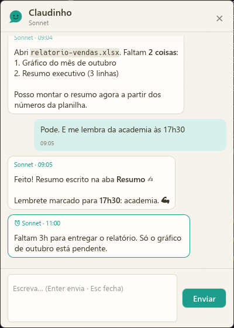

<p align="center">
  
</p>

<h1 align="center">Claudinho</h1>

<p align="center">
  <b>A tiny desktop buddy for Windows that puts a full Claude Code agent one click away — all day long.</b><br>
  Floating bubble · long-term memory · reminders · runs on your Claude subscription · ~10 MB idle
</p>

<p align="center">
  <a href="https://github.com/gabelfaria/claudinho/releases/latest"></a>
  
  
  <a href="LICENSE"></a>
</p>

<p align="center">
  <a href="README.pt-BR.md">🇧🇷 Leia em português</a> ·
  <a href="https://gabelfaria.github.io/claudinho/">Website</a>
</p>

---



**Claudinho** lives in a small bubble in the corner of your screen. Click it and you are talking to **Claude Code** — the real agent, with access to your files, PowerShell, the web, your browser and your connectors — not a toy chatbot.

It remembers you across days, pings you at the right time, and stays out of the way when you are gaming. And it was built obsessively to be **light on RAM and light on your Claude quota**.

- 🫧 **Always one click away.** Draggable bubble that snaps to the screen edge and hides during full-screen games.
- 🛠️ **A real agent.** Reads and edits files, runs commands, searches the web, drives Chrome, uses MCP connectors and background agents. Risky actions show an **Allow / Deny** card in the chat.
- 🧠 **Remembers you.** One conversation for life, folded automatically into a compact long-term memory. Full history kept as readable Markdown on your disk.
- ⏰ **Reminders in plain language.** "Remind me to call the bank at 4pm" just works. Optional hourly check-ins (9am–10pm) that stay quiet when there is nothing useful to say.
- 🪶 **Featherweight.** The watcher uses ~10 MB of RAM. The chat window is preloaded but trimmed to a few MB while hidden, and opens in ~0.2 s. The Claude Code session (~200 MB) closes itself after 10 idle minutes and resumes where it left off.
- 💸 **Quota-smart.** Sonnet leads, Opus is called only for hard problems and hands control back. A topic-change detector starts a fresh, lightweight session when you change subjects, so you never pay to re-read an old conversation.
- 🔑 **No API key.** Uses the Claude Code CLI with your Claude Pro/Max login.

<br clear="right">

## Install (one command)

Open **PowerShell** and paste:

```powershell
irm https://raw.githubusercontent.com/gabelfaria/claudinho/main/install.ps1 | iex
```

The installer:

1. installs **Claude Code** with Anthropic's official installer, if you don't have it, and asks you to log in;
2. downloads the latest Claudinho release to `%LOCALAPPDATA%\Programs\Claudinho`;
3. asks what Claudinho should call you;
4. adds it to the Start menu and to Windows startup, then opens it.

No admin rights needed. Prefer to do it by hand? Grab the zip from [Releases](https://github.com/gabelfaria/claudinho/releases/latest), extract it anywhere and run `claudinho.exe`.

**Requirements:** Windows 10/11 x64 and a Claude plan that includes Claude Code (Pro or Max).

## How to use

| Action | How |
|---|---|
| Open the chat | Click the bubble (or the tray icon) |
| Send | `Enter` · new line with `Shift+Enter` |
| Close the chat | `Esc` or `×` (it goes back to the bubble) |
| Stop the current answer | **Stop** button |
| Fresh conversation | type `/clear` (long-term memory is kept) |
| Set a reminder | just ask: *"remind me at 6:30pm to go to the gym"* |
| Quit | right-click the bubble → **Sair do Claudinho** |

## Make it yours

Everything lives in `%APPDATA%\Claudinho`:

- **`config.json`** — your name, the folder Claude Code works in (`pasta_trabalho`), where the data goes (`pasta_dados`) and which prompt to use.
- **`prompt.md`** — Claudinho's personality and rules. Write your routine, goals and house rules here; it is appended to Claude Code's own system prompt.
- **`dados\agenda.md`** — optional weekly plan; it is injected into every new session.
- **`dados\conversa\*.md`** — your full chat history, one readable file per month.
- **`dados\memoria-longa.md`** — what Claudinho remembers about you (you can edit it).

## Under the hood

```
claudinho.exe      Win32 watcher (bubble, tray, reminders, hourly check-ins)   ~10 MB RAM
claudinho-ui.exe   chat window (Rust + egui), preloaded and trimmed while hidden
claude.exe         one continuous Claude Code session (stream-json), resumed with --resume
```

- **Memory that doesn't grow:** every ~40 messages, Haiku folds the oldest ones into `memoria-longa.md` (≤ 4,000 characters). New sessions start from that summary plus the last messages, so the prompt stays small forever.
- **Automatic fresh starts:** before each message, Sonnet (no tools, ~2k tokens) checks whether you changed subject; if so, the request moves to a clean session. Sessions are also reset past ~110k tokens of context or after 60 minutes of silence.
- **Lean internal calls:** background jobs (memory, check-ins, topic detection) run with `--strict-mcp-config`, which we measured at **~2k tokens instead of ~216k** when many MCP connectors are installed.
- **Safety:** it runs in Claude Code's `auto` permission mode; anything that needs approval becomes an Allow/Deny card. Hourly check-ins are read-only, enforced in code.

## Privacy

Claudinho has no server and no telemetry. Your conversation, memory and settings stay in plain files on your PC. Messages go only where Claude Code sends them: to Anthropic, under your own account.

## Build from source

```powershell
git clone https://github.com/gabelfaria/claudinho
cd claudinho
cargo build --release
# target\release\claudinho.exe, claudinho-ui.exe, claudinho-popup.exe
```

Bonus: `claudinho-popup.exe` is a small always-on-top prompt that scripts (or Claude itself) can use to ask you a question: `claudinho-popup --titulo "Deploy" --msg "Ship it?" --opcoes "Yes|No"` prints your answer to stdout.

## Uninstall

```powershell
irm https://raw.githubusercontent.com/gabelfaria/claudinho/main/uninstall.ps1 | iex
```

Your data in `%APPDATA%\Claudinho` is kept; delete the folder if you want it gone.

## Status

The interface is in **Portuguese** for now (Claudinho answers in your language). English UI and more languages are on the roadmap — contributions welcome!

---

<sub>Claudinho is an independent, unofficial project. It is not affiliated with, endorsed by or sponsored by Anthropic. Claude and Claude Code are trademarks of Anthropic, PBC. Claudinho uses the Claude Code CLI under your own account and is subject to Anthropic's terms.</sub>
