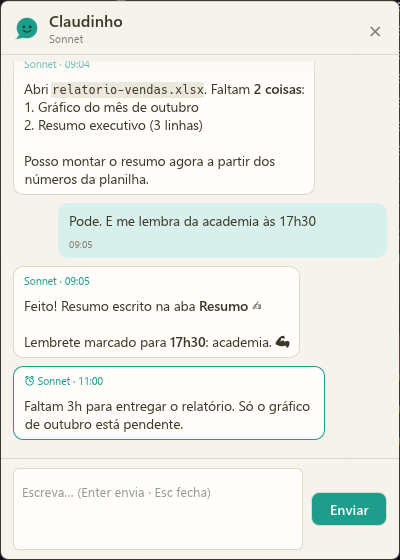

<p align="center">
  
</p>

<h1 align="center">Claudinho</h1>

<p align="center">
  <b>Um parceiro de mesa para Windows que deixa um agente Claude Code completo a um clique de distância, o dia inteiro.</b><br>
  Bolha flutuante · memória longa · lembretes · usa a sua assinatura do Claude · ~10 MB parado
</p>

<p align="center">
  <a href="https://github.com/gabelfaria/claudinho/releases/latest"></a>
  
  
  <a href="LICENSE"></a>
</p>

<p align="center">
  <a href="README.md">🇺🇸 Read in English</a> ·
  <a href="https://gabelfaria.github.io/claudinho/">Site</a>
</p>

---



O **Claudinho** mora numa bolhinha no canto da tela. Clicou, você está falando com o **Claude Code**: o agente de verdade, que mexe nos seus arquivos, roda PowerShell, pesquisa na web, usa o seu navegador e os seus conectores. Não é um chatbot de enfeite.

Ele lembra de você de um dia para o outro, te chama na hora certa e some quando você está jogando. E foi feito com obsessão para **gastar pouca RAM e pouca quota do Claude**.

- 🫧 **Sempre a um clique.** Bolha que você arrasta, gruda na borda da tela e se esconde em jogos em tela cheia.
- 🛠️ **Um agente de verdade.** Lê e edita arquivos, roda comandos, pesquisa, controla o Chrome, usa conectores MCP e agentes em segundo plano. Ações delicadas aparecem no chat com os botões **Permitir / Negar**.
- 🧠 **Lembra de você.** Uma conversa só, para a vida toda, resumida sozinha numa memória longa compacta. O histórico completo fica em Markdown legível no seu disco.
- ⏰ **Lembretes falando normal.** "Me lembra de ligar pro banco às 16h" e pronto. Verificações de hora em hora (9h–22h) que ficam quietas quando não há nada útil a dizer.
- 🪶 **Levíssimo.** O vigia usa ~10 MB de RAM. A janela de conversa fica pré-carregada, mas encolhida para poucos MB enquanto escondida, e abre em ~0,2 s. A sessão do Claude Code (~200 MB) fecha sozinha após 10 min parada e retoma de onde parou.
- 💸 **Economiza quota.** O Sonnet conduz; o Opus só entra em problema difícil e devolve o controle. Um detector de mudança de assunto abre uma sessão nova e leve quando você troca de tema, para você nunca pagar para reler uma conversa antiga.
- 🔑 **Sem chave de API.** Usa o Claude Code com o login da sua assinatura Pro/Max.

<br clear="right">

## Instalação (um comando)

Abra o **PowerShell** e cole:

```powershell
irm https://raw.githubusercontent.com/gabelfaria/claudinho/main/install.ps1 | iex
```

O instalador:

1. instala o **Claude Code** pelo instalador oficial da Anthropic, se você não tiver, e pede o login;
2. baixa a última versão do Claudinho em `%LOCALAPPDATA%\Programs\Claudinho`;
3. pergunta como o Claudinho deve te chamar;
4. coloca no menu Iniciar e para iniciar com o Windows, e abre.

Não precisa de administrador. Prefere fazer na mão? Baixe o zip em [Releases](https://github.com/gabelfaria/claudinho/releases/latest), extraia onde quiser e rode o `claudinho.exe`.

**Requisitos:** Windows 10/11 64 bits e um plano do Claude que inclua o Claude Code (Pro ou Max).

## Como usar

| Ação | Como |
|---|---|
| Abrir a conversa | Clique na bolha (ou no ícone da bandeja) |
| Enviar | `Enter` · nova linha com `Shift+Enter` |
| Fechar a conversa | `Esc` ou `×` (volta para a bolha) |
| Parar a resposta | botão **Parar** |
| Conversa nova | digite `/clear` (a memória longa continua) |
| Lembrete | é só pedir: *"me lembra às 18h30 de ir pra academia"* |
| Sair | botão direito na bolha → **Sair do Claudinho** |

## Deixe com a sua cara

Tudo fica em `%APPDATA%\Claudinho`:

- **`config.json`**: seu nome, a pasta onde o Claude Code trabalha (`pasta_trabalho`), onde ficam os dados (`pasta_dados`) e qual prompt usar.
- **`prompt.md`**: a personalidade e as regras do Claudinho. Escreva sua rotina, objetivos e combinados; ele é somado ao prompt do próprio Claude Code.
- **`dados\agenda.md`**: plano da semana (opcional), colado em toda sessão nova.
- **`dados\conversa\*.md`**: o histórico completo, um arquivo legível por mês.
- **`dados\memoria-longa.md`**: o que o Claudinho lembra de você (dá para editar).

## Por dentro

```
claudinho.exe      vigia Win32 (bolha, bandeja, lembretes, verificações)      ~10 MB de RAM
claudinho-ui.exe   janela de conversa (Rust + egui), pré-carregada e encolhida
claude.exe         uma sessão contínua do Claude Code (stream-json), retomada com --resume
```

- **Memória que não cresce:** a cada ~40 mensagens, o Haiku dobra as mais antigas em `memoria-longa.md` (até 4.000 caracteres). Sessões novas começam desse resumo mais as últimas mensagens, então o prompt fica pequeno para sempre.
- **Recomeços automáticos:** junto com cada mensagem, o Sonnet (sem ferramentas, ~2 mil tokens) confere se você mudou de assunto; se mudou, o pedido vai para uma sessão limpa. A sessão também é zerada acima de ~110 mil tokens de contexto ou depois de 60 min sem conversa.
- **Chamadas internas enxutas:** as tarefas de fundo (memória, verificações, assunto) rodam com `--strict-mcp-config`, o que medimos em **~2 mil tokens em vez de ~216 mil** quando há muitos conectores MCP instalados.
- **Segurança:** roda no modo de permissão `auto` do Claude Code; o que precisa de aprovação vira um cartão Permitir/Negar. As verificações de hora em hora são só leitura, garantido no código.

## Privacidade

O Claudinho não tem servidor nem telemetria. Conversa, memória e configurações ficam em arquivos comuns no seu PC. As mensagens só vão para onde o Claude Code manda: para a Anthropic, na sua própria conta.

## Compilar

```powershell
git clone https://github.com/gabelfaria/claudinho
cd claudinho
cargo build --release
# target\release\claudinho.exe, claudinho-ui.exe, claudinho-popup.exe
```

Bônus: o `claudinho-popup.exe` é uma janelinha sempre no topo para scripts (ou o próprio Claude) te perguntarem algo: `claudinho-popup --titulo "Deploy" --msg "Pode subir?" --opcoes "Sim|Não"` devolve a resposta no stdout.

## Desinstalar

```powershell
irm https://raw.githubusercontent.com/gabelfaria/claudinho/main/uninstall.ps1 | iex
```

Seus dados em `%APPDATA%\Claudinho` ficam guardados; apague a pasta se quiser.

---

<sub>O Claudinho é um projeto independente e não oficial. Não tem vínculo, aval nem patrocínio da Anthropic. Claude e Claude Code são marcas da Anthropic, PBC. O Claudinho usa o Claude Code na sua própria conta e segue os termos da Anthropic.</sub>
